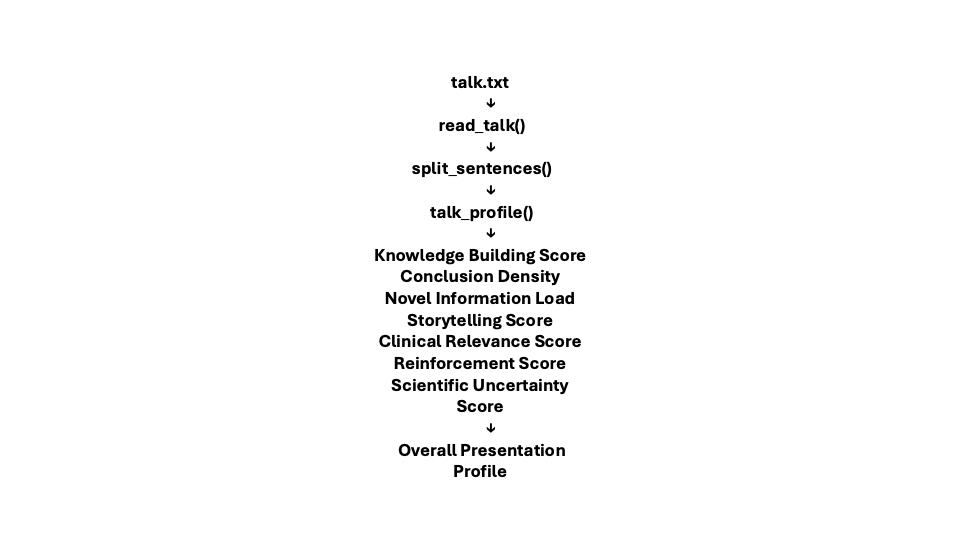

 # TalkScore

TalkScore is an R package for semantic analysis of presentation scripts and 
speaker notes. It classifies content into categories such as background, 
evidence, conclusions, uncertainty, clinical relevance, and knowledge gaps, 
generating scores that evaluate scientific storytelling and
communication quality.


# Installation
You can install the development version of talkscore from a local source:

install.packages("devtools")
devtools::install_github("Mare479/talkscore",dependencies = TRUE,
  build_vignettes = TRUE)

# Example
Load the package and analyze a presentation script using speaker notes:

```
library(talkscore)
f <- system.file("extdata", "talk.txt", package = "talkscore") # Load example presentation
profile <- talk_profile(f) # Generate an overall score of your talk 
profile # View

# Examine reinforcement of key scientific concepts across slides
profile$details$reinforcement$by_slide
```
# Metrics

TalkScore currently provides the following metrics: Knowledge Building Score, 
Conclusion Density, Novel Information Load, Storytelling Score, Clinical 
Relevance Score, Reinforcement Score, Scientific Uncertainty Score.

These metrics are combined into an overall presentation profile that can be 
used to assess the communication flow of scientific talks.



# Future Development

Future versions will use automated language analysis and machine 
learning approaches to distinguish presentations intended for scientific, 
clinical, or public audiences without relying on manually curated keyword 
dictionaries. We hope these and similar algorithms will also help scientists 
with grant writing and scientific communication overall.


